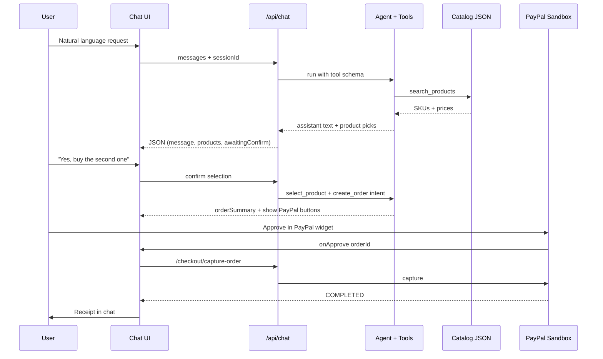

# ShopPal — Architecture

## Stack

| Layer | Choice | Rationale |
|-------|--------|-----------|
| UI | **Next.js 15** (App Router), **React 19**, **TypeScript** | Fast hackathon delivery, easy hosted demo |
| Styling | **Tailwind CSS 4** | Matches DESIGN.md tokens |
| Agent | **OpenAI-compatible** chat completions + **function tools** | Hackathon-standard; fallback if no key |
| Payments | **PayPal REST Orders API** + **@paypal/react-paypal-js** | Sandbox checkout, judge-visible flow |
| Catalog | **Static JSON** in `web/data/catalog.json` | No DB for MVP |
| Session | In-memory + optional **cookies** for `sessionId` | Render-ephemeral FS: no SQLite file dependency |
| Deploy | **Render** or **Vercel**; bind `0.0.0.0:$PORT` on Render | Sponsor + hackathon friendly |

## Repository layout

```
Paypal_hackathon/
├── PRD.md
├── ARCHITECTURE.md
├── DESIGN.md
├── RULES.md
├── TASKS.md
├── PROGRESS.md
├── README.md
├── submission/           # Hackathon deliverables & copy-paste fields
└── web/                  # Runnable application
    ├── app/
    │   ├── layout.tsx
    │   ├── page.tsx          # Chat shell
    │   ├── globals.css
    │   └── api/
    │       ├── chat/route.ts
    │       ├── checkout/create-order/route.ts
    │       └── checkout/capture-order/route.ts
    ├── components/
    │   ├── Chat.tsx
    │   ├── MessageBubble.tsx
    │   ├── ProductCard.tsx
    │   └── PayPalCheckout.tsx
    ├── lib/
    │   ├── agent/
    │   │   ├── tools.ts
    │   │   ├── system-prompt.ts
    │   │   └── run-agent.ts
    │   ├── catalog.ts
    │   ├── paypal.ts
    │   ├── session.ts
    │   └── types.ts
    └── data/catalog.json
```

## Data flow



## Agent tools (MVP)

| Tool | Purpose |
|------|---------|
| `search_products` | Query + optional `maxPriceUsd` → ranked catalog hits |
| `select_product` | Set session `selectedSku` (requires prior search) |
| `prepare_checkout` | Build line items for PayPal; set `awaitingPayment` |
| `get_session_summary` | Debug/demo: cart state for user |

**Hard rule:** `prepare_checkout` only runs if the last user message contains confirmation tokens (see `lib/agent/tools.ts`).

## PayPal integration

1. **Server:** `PAYPAL_CLIENT_ID`, `PAYPAL_CLIENT_SECRET`, `PAYPAL_MODE=sandbox`
2. **create-order:** POST with `sku` → PayPal Orders v2 `CREATE`
3. **Client:** PayPal Buttons `createOrder` returns server order ID; `onApprove` → capture route
4. **MCP (phase 2):** Run [PayPal MCP server](https://paypaldev.github.io/devdays-2025/) alongside dev; agent tools proxy to MCP instead of direct REST

## Security boundaries

- Secrets only in server env; never `NEXT_PUBLIC_` except PayPal **client id** (public by design)
- Capture endpoint validates `orderId` shape and session ownership
- Rate limit chat route (simple in-memory) optional P1

## Deployment notes (Render)

- Web service root: `web`
- Build: `npm ci && npm run build`
- Start: `npm run start` (Next binds `PORT`)
- Ephemeral disk: session store is in-memory; demo uses single-instance expectations
