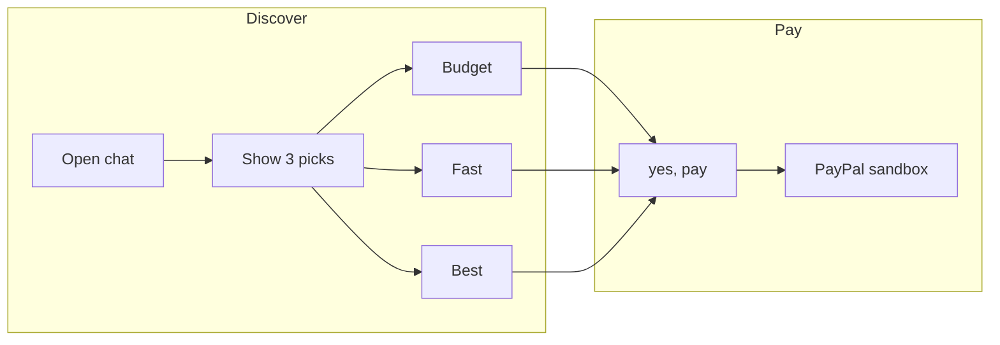
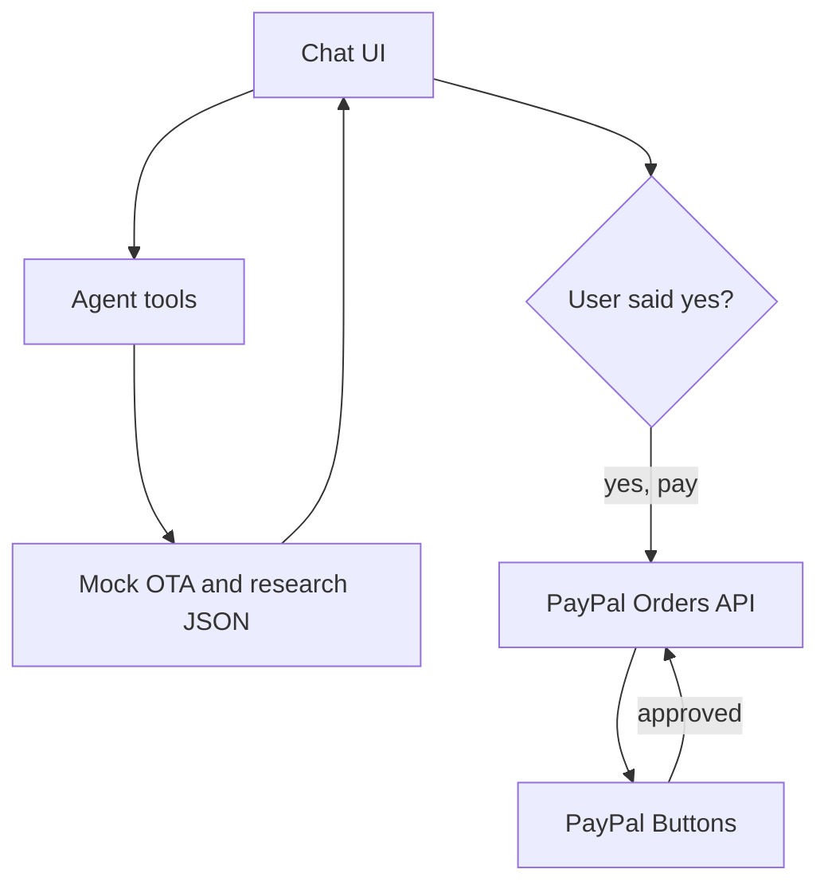
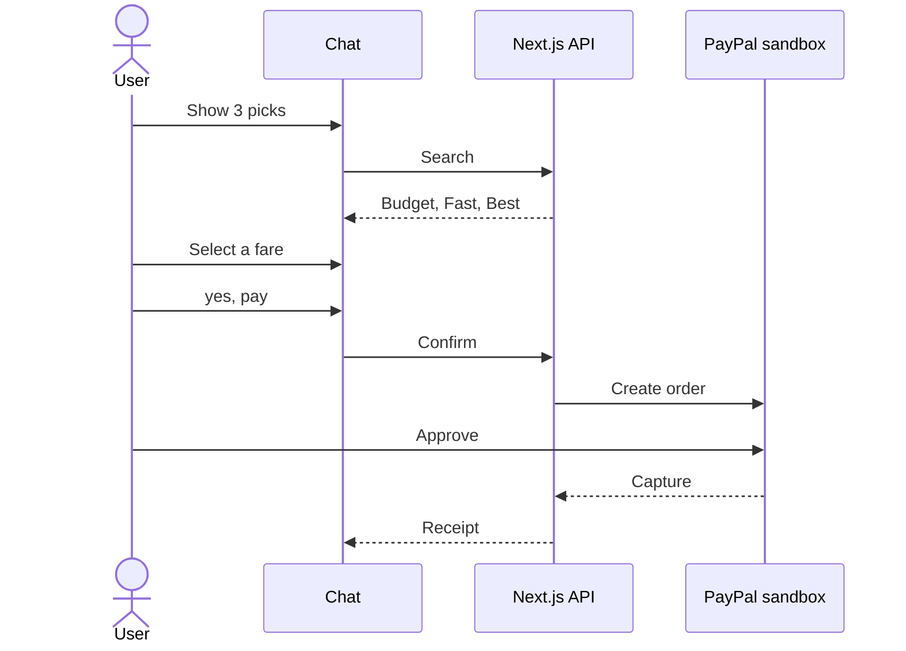

# ShopPal

ShopPal is an agentic checkout for the PayPal AI Hackathon. It turns a plain-language goal into three priced options, waits for an explicit yes, and completes payment in the PayPal sandbox.

**No more fatigue. Just PayPal.** Pick in chat, then yes, then PayPal.

| | |
|---|---|
| Live demo | [shoppal-app.vercel.app](https://shoppal-app.vercel.app) |
| Chat | [shoppal-app.vercel.app/chat](https://shoppal-app.vercel.app/chat) |
| Stack | Next.js 15, React 19, TypeScript, Tailwind CSS 4 |
| Payments | PayPal Orders API v2 and JavaScript SDK (sandbox) |
| Agent | OpenAI tool calling (`gpt-4o-mini`), or a deterministic fallback |

Default fares are indicative. They come from a mock OTA and public research, not live inventory.

## Demo

Sarah Jenkins is connecting Boston to Dallas when AA 2184 (DFW to Kansas City) is canceled for weather at Gate C19. She can keep the Kansas City stop (MCI) or continue home to Omaha (OMA).



1. Open `/chat`.
2. Choose a destination and mode, then **Show 3 picks**.
3. Select **Budget**, **Fast**, or **Best**.
4. Confirm with **yes, pay**.
5. Approve in the PayPal sandbox. Without sandbox keys, the screen offers **Simulate PayPal approval**.

The story plays out in `/chat`: a weather cancel at Dallas, then a rebook toward Kansas City or Omaha.

## Architecture

The agent can search and hold a fare. It cannot create a PayPal order until the user confirms. Card data stays inside PayPal.





| Route | Role |
|-------|------|
| `GET /api/ota/v1/search` | Fare tracks for DFW to MCI or OMA |
| `POST /api/demo/select` | Hold a fare SKU |
| `POST /api/demo/confirm` | Record consent and open checkout |
| `POST /api/checkout/create-order` | Create a PayPal order |
| `POST /api/checkout/capture-order` | Capture after approval |
| `POST /api/chat` | Chat. Uses OpenAI tools when enabled, otherwise the fallback agent |

Source files: `web/data/mock-ota-thanksgiving.json`, `web/data/ground-public-research.json`, `web/data/dfw-oma-flight-research.json`.

Sessions live in memory. That is enough for this demo. A serverless cold start does not keep a shared cart.

## Run locally

```bash
cd web
cp .env.example .env.local
npm install
npm run dev
```

- Landing: http://localhost:3000
- Demo: http://localhost:3000/chat

If the app returns 500 after a large change:

```bash
cd web && npm run dev:clean
```

### Environment

Copy [`web/.env.example`](web/.env.example) to `web/.env.local`. Create a sandbox app at [developer.paypal.com](https://developer.paypal.com/dashboard/applications/sandbox).

| Variable | Role |
|----------|------|
| `PAYPAL_CLIENT_ID`, `PAYPAL_CLIENT_SECRET`, `PAYPAL_MODE=sandbox` | Orders API on the server |
| `NEXT_PUBLIC_PAYPAL_CLIENT_ID` | PayPal Buttons. Same sandbox client id |
| `OPENAI_API_KEY`, `OPENAI_MODEL`, `OPENAI_AGENT=true` | Optional model tools. Off by default |
| `DEMO_MODE` | Simulated checkout. Also used when PayPal credentials are missing |
| `FARE_PROVIDERS` | `mock` by default. Add `duffel` or `amadeus` only with those keys |

### Scripts

From `web/`:

```bash
npm run demo:mock-ota
npm run build && npm run test:e2e
npm run test:landing
```

`test:e2e` starts a production server on port 3010 in demo mode. To use a server that is already running:

```bash
PLAYWRIGHT_BASE_URL=http://127.0.0.1:3000 npm run test:e2e
```

## Repository

| Path | Purpose |
|------|---------|
| [`web/`](web/) | Next.js application |
| [`PRD.md`](PRD.md) | Product requirements |
| [`ARCHITECTURE.md`](ARCHITECTURE.md) | System notes |
| [`LICENSE`](LICENSE) | MIT |

## License

MIT. See [`LICENSE`](LICENSE).
